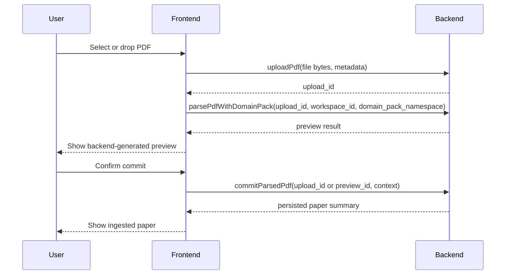

# PDF Ingestion Pipeline

This document defines the implementation pipeline for PDF ingestion in OntoForge.

It is intentionally narrower than the full LLM plan. The goal here is to describe how a PDF moves from a source document into structured OntoForge data, using the current backend architecture as the foundation.

## Goal

Build a backend-first PDF ingestion workflow that:

- accepts a PDF in the context of a workspace and active domain pack
- works when the backend is deployed on a separate server from the desktop or web client
- extracts text, layout, formulas, and paper metadata
- grounds semantic extraction in the active domain pack
- produces structured candidate assertions with evidence links
- persists extracted artifacts through the existing ingestion pipeline
- supports a safe preview mode before commit

## Current Baseline

The current codebase already contains the persistence-side foundation for ingestion:

- `backend/services/ingestion_service.py` persists `PaperNode`, `ChunkNode`, `FormulaNode`, and subdomain assignments
- `backend/schemas/protocol.py` already defines `sspIngest` and `sspExtract` shapes for later-stage data insertion
- the LLM provider abstraction exists and can already produce structured outputs

What does not exist yet is a real PDF parsing orchestrator.

That means this phase should add an orchestration layer above the current persistence layer, not replace the persistence layer.

## Design Principles

1. Deterministic extraction first, model interpretation second.
Do not ask an LLM to parse raw PDF bytes directly when layout/text extraction can be done deterministically.

2. Domain-pack grounding is mandatory.
All semantic extraction must be constrained by the selected domain pack rather than relying on open-ended prompting.

3. Preview before commit.
The first production-safe path should allow parsing and inspection without writing to the graph.

4. Evidence must remain first-class.
Candidate assertions must preserve provenance back to chunks, formulas, and page-level source context.

5. Partial success is normal.
The API should return usable partial outputs even when formulas, tables, metadata, or assertions are incomplete.

6. Reuse the existing ingestion service for persistence.
The new PDF pipeline should feed the current graph persistence path rather than inventing a second commit path.

7. Remote-backend transport is the default assumption.
The ingestion contract must work over the network without depending on Electron IPC or local file paths.

## End-to-End Pipeline

The recommended ingestion flow is:

1. PDF upload to backend-managed temporary storage
2. Parse request against uploaded PDF
3. Deterministic document extraction
4. Intermediate document normalization
5. Domain-pack grounding
6. Semantic extraction and normalization
7. Preview assembly
8. Optional commit into the graph
9. Post-ingestion classification and audit reporting

## Deployment Assumption

The frontend and backend should be treated as separate deployable systems.

That means:

- the frontend may run in Electron today and a browser tomorrow
- the backend may run on another machine, container, or service host
- the backend cannot rely on reading a client-local filesystem path
- Electron IPC may still exist as a frontend implementation detail, but it must not be the primary ingestion contract

The canonical PDF ingestion path should therefore be network-based.

## Transport Model

The transport should be split into two backend-facing steps.

1. `uploadPdf`
The frontend uploads the selected PDF bytes to backend-managed temporary storage.

2. `parsePdfWithDomainPack`
The frontend requests parsing using the returned upload identifier plus workspace/domain-pack context.

This keeps the core contract transport-neutral.

Electron can call the same upload API.
A future browser client can call the same upload API.
Neither client needs a privileged local-path bridge to make ingestion work.

### Recommended High-Level Flow

## Frontend vs Backend Split

The pipeline should be split strictly by responsibility.

### Frontend Responsibilities

The frontend should only handle user interaction, local file selection, and rendering of structured results.

Frontend functions should include:

- selecting a PDF file
- selecting the target workspace
- selecting the active domain pack namespace
- setting parse options such as preview vs commit
- uploading the PDF to the backend
- sending typed preview and commit requests to the backend
- rendering preview results, warnings, and confidence summaries
- allowing the user to confirm or cancel commit after preview
- showing ingestion progress and final status

The frontend should not:

- parse PDF contents
- build extraction prompts
- interpret domain-pack YAML into model instructions
- normalize assertions
- write graph objects directly

### Backend Responsibilities

The backend should own all parsing, normalization, validation, orchestration, and persistence.

Backend functions should include:

- validating workspace and domain-pack context
- accepting and storing uploaded PDFs in temporary backend-managed storage
- loading and grounding the domain pack
- reading PDF content from uploaded backend storage
- extracting text, layout, formulas, and metadata
- normalizing parsed content into the intermediate document model
- generating structured semantic extraction results
- validating extracted artifacts against OntoForge schemas
- persisting accepted results into the graph
- returning structured preview and commit responses

## Function Ownership Along The Pipeline

Each stage should have a clear owner.

### Stage 1: Input Acquisition

Frontend functions:

- open file picker or accept drag/drop
- capture selected `workspace_id`
- capture selected `domain_pack_namespace`
- collect parse options and desired mode
- upload PDF bytes to backend temporary storage

Backend functions:

- accept uploaded bytes and return a stable `upload_id`
- validate that the workspace exists and is accessible
- validate that the selected domain pack is active for the workspace
- validate uploaded file metadata and size constraints
- compute provenance hash and ingestion identifiers

## Stage 1: Input Acquisition

The entry point should accept:

- `workspace_id`
- `owner_id` when required
- `domain_pack_namespace`
- an `upload_id` referencing backend-managed temporary PDF storage
- parse options
- execution mode: `preview` or `commit`

Expected behavior:

- receive PDF bytes through `uploadPdf`
- persist the upload into backend-managed temporary storage
- return an `upload_id` that the parse request can reference
- validate that the workspace exists and is accessible
- validate that the referenced domain pack is active for that workspace
- verify that the referenced upload exists and is readable
- compute a provenance hash early so deduplication and re-ingestion checks are possible

## Stage 2: Deterministic Document Extraction

Frontend functions:

- submit the parse request
- optionally show progress state while the backend extracts document structure

Backend functions:

- load the PDF bytes or file stream from backend-managed upload storage
- run deterministic text and layout extraction
- detect text blocks, pages, formulas, and optional tables
- emit parser warnings for damaged or low-quality PDFs

This stage should use a non-LLM document parser to extract raw structure from the PDF.

Outputs should include:

- page-level text blocks
- section boundaries where possible
- figure and table placeholders when enabled
- formulas with bounding boxes where possible
- candidate metadata such as title, authors, year, venue, DOI

This stage should not try to infer domain meaning yet.

Its job is to turn the PDF into a structured machine-readable representation.

## Stage 3: Intermediate Document Model

Frontend functions:

- none beyond displaying backend-produced structural previews if requested

Backend functions:

- normalize raw parser output into internal document model objects
- preserve page references, block IDs, and bounding boxes
- prepare stable inputs for later semantic extraction

Introduce an internal normalized representation between raw PDF parsing and domain-aware extraction.

Suggested model families:

- `ParsedPdfDocument`
- `ParsedPage`
- `TextBlock`
- `FormulaBlock`
- `TableBlock`
- `ParsedPaperMetadata`

This layer is important because it gives the system one stable structure regardless of which underlying PDF parser is used.

It also makes testing much cheaper, because later extraction stages can be exercised without depending on raw PDF parsing every time.

## Stage 4: Domain-Pack Grounding

Frontend functions:

- none

Backend functions:

- load the selected domain pack configuration
- compile extraction vocabulary and allowed schema constraints
- build prompt-safe extraction context for semantic parsing

Before semantic extraction begins, build a compact domain extraction context from the selected domain pack.

That context should include:

- metric names
- aliases and synonyms
- expected units
- taxonomy vocabulary
- allowed predicate types
- domain-specific context fields

The domain pack should be transformed into a constrained extraction context rather than passed through as raw YAML.

This is the stage that prevents the model from inventing unsupported metrics or schema fields.

## Stage 5: Semantic Extraction and Normalization

Frontend functions:

- none

Backend functions:

- refine ambiguous metadata fields
- map text and formulas to known metrics and entities
- generate candidate assertions and evidence links
- assign confidence, warnings, and unresolved ambiguity markers
- validate output against protocol and schema types

This stage uses the parsed document model plus domain-pack context to generate structured OntoForge candidates.

Responsibilities:

- refine paper metadata when deterministic extraction is ambiguous
- map text and formulas to known metrics and entities
- identify candidate assertions
- infer context conditions
- attach evidence links to chunks and formulas
- attach confidence scores and warnings

The output here should be structured and validated, not freeform prose.

Typical outputs:

- normalized `PaperMetadata`
- extracted chunks for persistence
- extracted formulas for persistence
- candidate assertions
- evidence links
- subdomain hints
- extraction warnings

## Stage 6: Preview Mode

Frontend functions:

- render preview output for inspection
- display warnings, confidence, and unresolved items
- allow the user to accept, revise options, or cancel

Backend functions:

- return structured preview payload without graph writes
- provide stable identifiers needed for a later commit step if applicable

The first user-facing operational mode should be `preview`.

In preview mode the system:

- parses the PDF
- runs domain-pack grounding
- produces structured extraction output
- does not write to Neo4j

This mode is important because PDF extraction quality will vary, and the team needs a safe way to inspect results before persisting them.

Preview response should include:

- `upload_id` or `preview_id` needed for later commit
- extracted metadata
- chunk count and chunk previews
- formulas detected
- candidate assertions
- subdomain recommendations
- confidence summary
- warnings and unresolved ambiguities

## Stage 7: Commit Mode

Frontend functions:

- send explicit confirmation to commit the previewed ingestion result
- show final persisted status and identifiers

Backend functions:

- create or upsert graph nodes and relationships
- route persistence through the ingestion service
- attach provenance and extraction metadata
- return persisted IDs and commit warnings

Commit mode takes a parsed result and persists it into the graph.

This stage should reuse the existing persistence-side services wherever possible.

Commit should not require the frontend to re-upload the PDF.
It should operate on the previously uploaded artifact or on a stable preview artifact identifier returned by preview mode.

At minimum, commit should:

- create or upsert the `PaperNode`
- create `ChunkNode` entries
- create `FormulaNode` entries
- create relationships between paper and extracted artifacts
- run subdomain classification or use extraction hints
- record provenance hash and extraction metadata

The existing `backend/services/ingestion_service.py` should remain the main commit-layer dependency for this path.

## Stage 8: Post-Ingestion Outputs

Frontend functions:

- display ingestion summary
- surface any manual review recommendations
- link the user into the next relevant UI state

Backend functions:

- assemble the final ingestion report
- include subdomain assignments, warnings, and persistence summary
- expose any audit or review metadata required by later workflows

After commit, the system should return a structured ingestion report.

Suggested report fields:

- `paper_id`
- persistence status
- number of chunks created
- number of formulas created
- number of candidate assertions extracted
- subdomain assignments
- warnings
- whether manual review is recommended

This response should be suitable both for frontend display and later audit logging.

## Preview vs Commit Contract

The pipeline should support two execution modes.

### Preview

Use when:

- testing extraction quality
- validating domain-pack grounding
- reviewing ambiguous outputs
- avoiding accidental graph pollution

Behavior:

- no database writes
- full structured extraction report returned

### Commit

Use when:

- the parsed result is considered acceptable
- the user confirms ingestion
- the system is running a trusted automated pipeline later on

Behavior:

- writes to the graph
- returns ingestion summary and persisted identifiers

## Failure Model

The ingestion system should not model success as all-or-nothing.

Expected partial outcomes include:

- metadata extracted, but no formulas found
- chunks extracted, but assertions are low-confidence
- formulas found, but variable mapping is incomplete
- domain-pack metric mapping is ambiguous
- subdomain classification is uncertain

The response should therefore include:

- `status`
- `warnings`
- `errors`
- `manual_review_recommended`
- confidence summaries by artifact type

## Recommended Backend Surfaces

The first explicit backend method for this pipeline should remain small and typed.

Suggested method:

- `uploadPdf`
- `parsePdfWithDomainPack`
- `commitParsedPdf`

Suggested request concepts:

- workspace context
- domain-pack namespace
- upload identifier
- parse options
- mode: `preview` or `commit`

Suggested response concepts:

- paper metadata
- extracted chunks and formulas
- candidate assertions
- evidence summary
- subdomain hints or assignments
- warnings and confidence
- persisted IDs when in commit mode

## Suggested API Boundary

The frontend-backend contract should stay thin.

### Frontend-facing calls

The frontend should only need a small set of high-level actions:

- `uploadPdf`
- `parsePdfWithDomainPack` in `preview` mode
- `commitParsedPdf` as a dedicated follow-up commit call
- status and error rendering based on the backend response

### Backend-internal functions

The backend should internally split the workflow into composable functions such as:

- `store_uploaded_pdf(...)`
- `load_uploaded_pdf(...)`
- `extract_pdf_structure(...)`
- `normalize_parsed_document(...)`
- `build_domain_extraction_context(...)`
- `extract_structured_candidates(...)`
- `build_preview_result(...)`
- `commit_ingestion_result(...)`

These internal functions should not be exposed directly to the frontend.

## Sidebar Import Queue Checklist

Before wiring backend PDF parsing, the sidebar should own the local paper intake lifecycle through a staged import queue.

- keep persisted graph papers and staged sidebar imports as separate state collections
- treat the left paper list as the source of truth for files the user is preparing to ingest
- support both `+` batch import and drag/drop through the same enqueue path
- assign each staged file an explicit lifecycle status such as `queued`, `validating`, `preview_ready`, `ingesting`, or `error`
- keep staged imports visible in the sidebar even before they exist in the matrix or graph
- only allow matrix row selection for persisted papers, not for pre-ingestion queue entries
- allow removal of staged imports without mutating persisted graph papers
- keep destructive removal of persisted papers behind an explicit confirmation dialog with title, evidence count, and irreversibility warning
- surface backend-generated preview metadata in the queue, such as parsed title, year, assertion count, and evidence count
- support retry for queue entries that fail during upload, parse, or preview preparation
- persist the staged queue locally so refresh does not silently discard in-flight imports
- ensure backend commit promotes a staged queue item into a persisted paper instead of creating a parallel duplicate entry
- do not mark an entry `preview_ready` from locally fabricated assertions or evidence counts

## Recommended File Touchpoints

Existing files likely to change:

- `frontend/renderer/services/ssp_client.ts`
- `frontend/renderer/services/workspace.ts`
- `backend/services/ingestion_service.py`
- `backend/server/jsonrpc_methods.py`
- `backend/schemas/protocol.py`

Likely new files:

- a PDF ingestion orchestrator service
- a temporary upload storage service or helper
- an intermediate parsed-document model module
- a domain-pack grounding builder for extraction prompts and normalization
- a semantic extraction service that maps parsed document content into OntoForge artifacts

## Recommended Implementation Order

### Phase 1: Contracts

- define request/response schemas for PDF upload, preview parsing, and commit
- define intermediate document model types
- define structured extraction result types

### Phase 2: Upload Transport

- implement `uploadPdf`
- persist uploads in backend-managed temporary storage
- define upload expiry and cleanup behavior

### Phase 3: Deterministic Parsing Adapter

- integrate one deterministic PDF extraction layer
- normalize outputs into the internal parsed-document model

### Phase 4: Domain-Pack Grounding

- compile active domain pack into a compact extraction context
- add helpers for metric/unit/taxonomy matching

### Phase 5: Semantic Extraction

- implement metadata refinement
- implement candidate assertion extraction
- implement evidence-link generation
- attach confidence and warnings

### Phase 6: Orchestration

- add preview flow from uploaded artifact to backend-generated preview
- add commit flow from preview artifact to persistence
- route commit through existing ingestion persistence

### Phase 7: Validation

- unit tests for schema validation
- unit tests for upload lifecycle and cleanup
- mocked tests for semantic extraction
- JSON-RPC tests for upload, preview, and commit modes
- integration tests for full pipeline behavior

## What Not To Do

- do not let the frontend build prompts or orchestrate extraction logic
- do not make raw PDFs the direct input to freeform LLM prompting without deterministic preprocessing
- do not commit parsed results immediately without a preview path in the initial implementation
- do not drop evidence provenance from candidate assertions
- do not create a second persistence pipeline separate from the existing ingestion service
- do not rely on client-local file paths as the primary contract when the backend is deployed remotely
- do not mark queue entries as previewed from locally fabricated semantic output

## Summary

The PDF ingestion pipeline should be built as a staged backend workflow:

1. upload the PDF to backend-managed temporary storage
2. parse the uploaded artifact in preview mode
3. deterministically extract document structure
4. normalize into an internal document model
5. ground extraction in the active domain pack
6. use structured semantic extraction to produce OntoForge artifacts
7. preview results safely
8. commit through the existing ingestion/persistence layer

That path keeps the system testable, domain-aware, compatible with remote backend deployment, and aligned with the graph model that already exists.