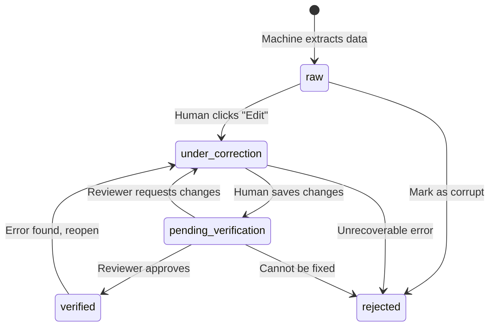

# HITL Correction Loop: Edit Surface State Machine

## Overview

OntoForge implements a **Correction-in-the-Loop** model, not just approval/rejection. The "loop" means humans can **edit and fix** machine-generated data, not just approve it.

## Key Principle

**HITL = Human actively participates in the correction workflow**

This is essential for:
- **Digital Microscope**: Correcting OCR errors inline
- **Formula Editor**: Fixing LaTeX parsing mistakes
- **Variable Mapper**: Adjusting semantic bindings

## State Machine: 5-State Model

### For Edit Surface Nodes (ChunkNode, FormulaNode)

```
┌─────────────────────────────────────────────────────────────────┐
│  State                  │ Description                            │
├─────────────────────────┼────────────────────────────────────────┤
│  raw                    │ Machine-generated, untouched by human  │
│  under_correction       │ Human actively editing (UI locked)     │
│  pending_verification   │ Edited, awaiting review                │
│  verified               │ Approved as correct                    │
│  rejected               │ Marked as unusable/invalid             │
└─────────────────────────────────────────────────────────────────┘
```

### State Transitions



## Implementation Details

### ChunkNode (OCR Corrections)

```python
class ChunkNode(BaseModel):
    id: str
    raw_text: str  # Editable field
    bounding_box: dict[str, Any]
    
    # HITL State
    verification_status: Literal[
        "raw",
        "under_correction",
        "pending_verification",
        "verified",
        "rejected"
    ] = "raw"
    
    # Audit Trail
    last_modified_by: Optional[str] = None  # arbitrator_id
    last_modified_at: Optional[str] = None  # ISO 8601 timestamp
    modification_count: int = 0
```

### FormulaNode (LaTeX Corrections)

```python
class FormulaNode(BaseModel):
    id: str
    latex_string: str  # Editable field
    variables_map: dict[str, str]  # Editable field
    constraints: dict[str, Any]  # Editable field
    
    # HITL State
    verification_status: Literal[
        "raw",
        "under_correction",
        "pending_verification",
        "verified",
        "rejected"
    ] = "raw"
    
    # Audit Trail
    last_modified_by: Optional[str] = None
    last_modified_at: Optional[str] = None
    modification_count: int = 0
```

## Workflow Examples

### Example 1: OCR Error Correction

1. **System extracts chunk**: `status = "raw"`
   ```
   raw_text: "reconfiguraton delay"  # Typo from OCR
   ```

2. **User Alice clicks "Edit"**: `status = "under_correction"`
   - UI locks the chunk (no one else can edit)
   - Alice corrects: "reconfiguraton" → "reconfiguration"
   - `last_modified_by = "arbitrator_alice_20260523_143022"`
   - `modification_count = 1`

3. **Alice saves**: `status = "pending_verification"`
   - UI unlocks
   - Chunk flagged for review

4. **User Bob reviews**: `status = "verified"`
   - Bob approves Alice's correction
   - Chunk now consumable by Tier 2 (AssertionNode extraction)

### Example 2: LaTeX Parsing Error

1. **System parses formula**: `status = "raw"`
   ```latex
   latex_string: "\\tau = N \\cdot \\Delta t"
   variables_map: {"\\tau": "unknown", "N": "unknown"}  # Parser failed
   ```

2. **User Carol edits**: `status = "under_correction"`
   - Fixes variable mappings:
     - `"\\tau": "total_latency"`
     - `"N": "port_count"`
   - `modification_count = 1`

3. **Carol saves**: `status = "pending_verification"`

4. **User Dave reviews**: Finds error, sends back
   - `status = "under_correction"` (back to Carol)

5. **Carol fixes again**: `modification_count = 2`

6. **Dave approves**: `status = "verified"`

### Example 3: Unrecoverable Corruption

1. **System extracts chunk**: `status = "raw"`
   ```
   raw_text: "█▓▒░▒▓█" # Completely corrupted
   ```

2. **User examines**: Cannot be salvaged
   - `status = "rejected"`
   - Chunk excluded from downstream processing

## Why Audit Trail Matters

### 1. Accountability
- Track who made each edit
- Review edit history
- Revert if needed

### 2. Quality Control
- Enforce "different reviewer" policy
  - Editor cannot self-verify
  - Requires second pair of eyes
- Track modification count to flag problematic nodes
  - `modification_count > 5` → May need domain expert

### 3. Temporal Analysis
- Measure time-to-verification
- Identify bottlenecks
- Optimize review workflows

## Integration with Tier Architecture

### Tier 3 → Tier 2 Boundary

**Principle**: Tier 2 (AssertionNode) assumes Tier 3 (ChunkNode, FormulaNode) is deterministic.

**Implementation**:
- AssertionNode extraction **only uses** chunks/formulas with `status = "verified"`
- Raw/pending/rejected nodes are invisible to Tier 2 processing
- This maintains clean cognitive separation

### Query Example (Neo4j Cypher)

```cypher
// Get verified chunks for assertion extraction
MATCH (paper:PaperNode)-[:CONTAINS]->(chunk:ChunkNode)
WHERE chunk.verification_status = "verified"
RETURN chunk
```

## API Operations

### 1. Lock for Editing

```python
# SSP method: sspLockNode
{
  "method": "sspLockNode",
  "params": {
    "node_id": "paper_test#chunk_1",
    "arbitrator_id": "arbitrator_alice_20260523_143022"
  }
}
# Updates: verification_status = "under_correction"
```

### 2. Save Edits

```python
# SSP method: sspUpdateNode
{
  "method": "sspUpdateNode",
  "params": {
    "node_id": "paper_test#chunk_1",
    "updates": {
      "raw_text": "corrected text",
      "verification_status": "pending_verification",
      "last_modified_by": "arbitrator_alice_20260523_143022",
      "last_modified_at": "2026-05-23T14:30:22Z",
      "modification_count": 1
    }
  }
}
```

### 3. Approve/Reject

```python
# SSP method: sspVerifyNode
{
  "method": "sspVerifyNode",
  "params": {
    "node_id": "paper_test#chunk_1",
    "arbitrator_id": "arbitrator_bob_20260523_150000",
    "decision": "verified"  # or "rejected" or "needs_correction"
  }
}
# If needs_correction: status = "under_correction", notify original editor
```

## Comparison: Review vs Correction

| Aspect | Review Model (Simple) | Correction Model (OntoForge) |
|--------|----------------------|------------------------------|
| **Human Action** | Approve/Reject (binary) | Edit/Fix (active) |
| **States** | 2 (raw, verified) | 5 (raw, under_correction, pending, verified, rejected) |
| **Audit Trail** | Not needed | Essential (who, when, how many edits) |
| **UI** | Checkboxes | Edit surfaces (text editors, formula editors) |
| **Workflow** | One-shot decision | Iterative correction |
| **Example** | "Is this correct?" | "Fix this OCR error" |
| **Best For** | High-quality ML output | Noisy extraction (OCR, LaTeX parsing) |

## Design Rationale

### Why Not Just 3 States?

**Problem with raw/verified/rejected**:
- No state for "I'm editing this right now" (locking needed)
- No state for "I edited it, needs review" (different from raw)
- Loses information about correction workflow

### Why Separate Editor and Reviewer?

**Quality Control**:
- Confirmation bias: People tend to approve their own work
- Fresh eyes catch mistakes the editor missed
- Aligns with scientific peer review principles

### Why Track Modification Count?

**Signals**:
- `count = 0`: Never touched by human
- `count = 1-2`: Normal correction workflow
- `count > 5`: Problematic node, may need expert or different source

## Future Enhancements (Phase C+)

### 1. Full Version History

Store complete edit diffs:
```python
class ChunkNode:
    version: int
    previous_versions: List[Dict[str, Any]]
    # On edit: push current state to history, increment version
```

### 2. Visual Diff UI

Show side-by-side comparison:
- Before: Machine-extracted text
- After: Human-corrected text
- Highlighted changes

### 3. Rollback Support

Enable reverting to previous version if correction was wrong.

### 4. Collaborative Editing

Multiple arbitrators can suggest edits:
- Proposal system
- Vote-based approval
- Conflict resolution

---

## Summary

**HITL in OntoForge** = **Correction Loop**, not just approval.

- ✅ 5-state model supports full editing workflow
- ✅ Audit trail tracks who, when, how many edits
- ✅ Enforces quality via pending_verification state
- ✅ Maintains tier separation (only verified nodes consumed)
- ✅ Scales from individual corrections to collaborative review

This ensures **humans are truly "in the loop"** — actively participating in data quality improvement, not just rubber-stamping machine output.
