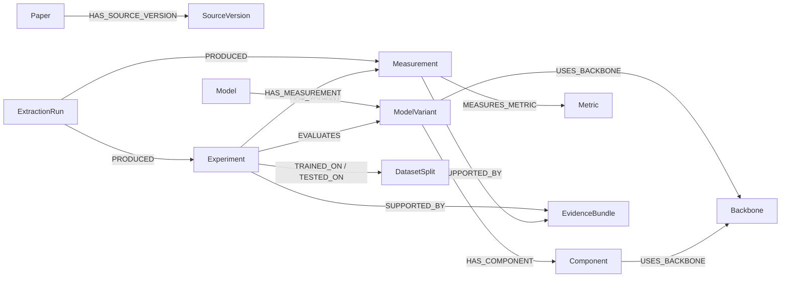

# CV 检测本体与约束

OntoForge 使用受约束的 Neo4j 属性图。结构模型位于 `backend/schemas/ontology.py`，可执行语义规则位于 `backend/services/ontology_constraints.py`。

## 身份规则

- 可变实体 ID 由 `workspace + domain + type + canonical local id` 生成，避免跨工作区误合并。
- 别名只在同一类型内精确规范化；模糊相似仅给候选，不自动合并。
- Model、ModelVariant、Component、Backbone 分型；角色由关系表达。
- 实验优先使用来源表格行/显式实验键。关键字段未知时加入 assertion ID，两个 `unknown` 不构成相同实验。
- Paper 按工作区、领域和文件哈希幂等；每次不可变预览形成新的 ExtractionRun。

## 核心约束

| rule_id | 约束 |
|---|---|
| `workspace_scope_v1` | 实验和测量必须属于同一工作区 |
| `run_provenance_v1` | 测量与实验必须来自同一 ExtractionRun |
| `measurement_owner_v1` | Measurement 必须指向其 Experiment |
| `dataset_time_not_per_image_v1` | 全数据集 110 秒不能成为每图 110000 ms 延迟 |
| `component_time_not_detector_latency_v1` | RPN/组件耗时不能成为整机延迟 |
| `per_class_not_overall_map_v1` | 类别 AP 不能成为整体 mAP |
| `relative_not_absolute_v1` | 相对提升不能成为绝对准确率 |
| `accuracy_requires_test_split_v1` | 已核验准确率必须有已消解测试集 |

字段支持状态为 `supported / contradicted / unresolved / not_applicable`。质量状态 `machine_checked` 不等于 `human_verified`；旧断言投影默认 `needs_review`，只有条件守卫完整通过时才可为 `machine_checked`。

## 可比性

- `accuracy_v1`：训练集、测试集和评价协议是硬条件。
- `speed_v1`：硬件、输入分辨率、batch size 和 timing scope 是硬条件。
- 缺字段返回 `partially_comparable`，硬条件冲突返回 `not_comparable`，不会无条件产生优劣边。
