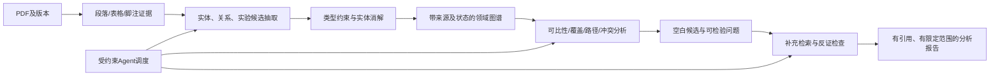

# OntoForge：面向课程原始要求的改进路线

日期：2026-10-30。

**Goal:** 把现有文献指标工作台推进为具有显式领域模式、实体消解、证据化知识表示和可解释研究空白发现机制的本体工作台。
**Architecture:** 保留React/JSON-RPC/FastAPI/Neo4j，在现有断言证据链上补充领域实体、实验身份、类型约束、实体对齐与图上分析。Agent作为调用这些受约束能力的调度层；自动实验执行属于后续扩展。
**Tech Stack:** 现有Python/Pydantic/Neo4j/TypeScript、用户已配置的DeepSeek。不为路线新增模型提供商或调用实验API。
**Spec:** 用户提供的原始选项3：摄取领域文献，将语义实体及关系提取到形式化图/本体，提供自动识别研究空白的机制；复杂性重点为形式化模式、实体消解、知识表示、图论抽象。

本文是实施前的设计路线，不表示新增功能已经实现。所有数量和质量门槛均为建议验收目标，不是当前成绩或老师规定。

## 一、先修正目标与范围

原要求没有明确要求通用自主科研、自动训练模型或保证发现全新科学成果。当前最高优先级是语义与知识复杂性，而非开放式代码执行Agent。原规格还包含分层人工纠错边界，保留人工确认不等于不满足自动化流水线。

最适合的课程交付目标：

> 系统从限定CV主题文献中提取模型、组件、数据集、实验与指标事实，通过实体对齐和语义约束形成可追溯图谱；基于明确图规则生成有依据、有限定范围的研究空白候选，并自动输出验证问题及文献依据。

自动执行科研实验、自动撰写完整论文、多Agent团队先列为扩展。不能把已有能力声明当可运行Agent，也不将新的聊天页面当核心复杂度。

## 二、当前证据与薄弱处

| 当前基础 | 已发现问题 | 对应应补能力 |
|---|---|---|
| 论文—片段—断言证据图 | 许多领域语义留在context字典里，关系难直接查询 | 明确Model、Component、DatasetSplit、Experiment、Metric等类型 |
| 指标别名及分类规则 | Fast/Faster、检测器/RPN、07+12/07++12易混淆 | 按类型和角色消解实体；训练集组成显式化 |
| 单位与数值校验 | 数字出现不代表归属正确；110秒总耗时误作每图延迟 | Measurement的对象、时间单位分母、实验范围与来源约束 |
| 新增条件引句校验 | 最终23条均缺少合格检测器骨干证据，可能过度降级 | 多证据组合、字段级证据及三态判定，避免关键词一票否决 |
| 方法×场景×指标覆盖 | 空单元可能只是漏提、未知、无效组合 | 质量过滤、可比性、合法组合、缺证据与候选研究问题分层 |
| 预览、事务、幂等与权限 | 同PDF重抽取不能自然形成多版本 | 导入身份与ExtractionRun/Review版本分离 |
| 三篇实跑和8条辅助核对数据 | 属于参与调试的样本，缺独立人工评估 | 固定标注集、新论文留出集和端到端评价 |

## 三、总体架构与语义模型

### 建议新增的最小领域模型

- Paper/SourceVersion：论文身份与固定源版本分开，保留文件哈希。
- Model：完整检测方法/具体实现；ModelVariant记录共享特征、SVD等变体。
- Component：RPN、检测头、backbone；通过HAS_COMPONENT连接，不能把组件当整机。
- Dataset与DatasetSplit：数据集、年份、trainval/test等组成；组合训练集以成员关系表达。
- Experiment：连接被评估模型、训练/测试集合、协议、硬件、分辨率及计时范围。
- Measurement/Assertion：某一实验在某指标上的报告值；记录单位、分母、范围与证据。
- Evidence：段落、表格单元、行列标题、脚注等定位；可多个证据共同支持一个字段。
- ExtractionRun/ReviewEvent：谁/什么模型/什么规则/什么版本产生或修正了记录。

Measurement不是漂浮的数字。73.2%应通过Experiment关联到相应模型和VOC07测试集；论文“报告此结果”与系统“判断结果已支持”分开保存。模型推测的关系先是候选，不自动成为已确认事实。

### 形式化约束例子

1. EVALUATED_ON的起点必须是Experiment，终点必须是DatasetSplit。
2. HAS_COMPONENT连接Model/ModelVariant与Component；RPN使用VGG16不推出检测器使用VGG16。
3. 一个measurement必须有metric、value、unit、experiment_id和证据引用。
4. 单图延迟的denominator为image；数据集总时间为dataset。s乘1000只换单位，不改变分母。
5. 训练集组合用成员集合判等；07+12与含VOC07 test的07++12不相同。
6. 不同硬件或计时范围不能形成未经限定的FASTER_THAN关系。
7. 不同源版本、实验条件或表格行不能仅因同值就自动合并；不同值也不直接等于科学矛盾。
8. 缺证据是unresolved，不等于violated；不确定性必须传播到比较和空白分析。

可继续使用带类型约束的Neo4j属性图完成课程目标。Pydantic只验证结构，需要额外语义规则。是否要求RDF/OWL/SHACL应由老师明确；没有此要求时不为名词迁移整套数据库，也不宣称当前已有OWL推理机。

## 四、阶段路线与验收

### P0：固定范围、验收问题与测试基准

**产物：** docs中的范围/模式说明、固定PDF版本清单、标注说明、开发/留出划分。

- [ ] 选一个窄主题，例如目标检测中准确率与推理效率的可比性。
- [ ] 先列5个系统必须回答的问题：同模型跨论文别名合并；同名组件与整机区分；训练集不同的结果不可直接排名；同条件相反报告的核对；缺少证据的合理组合如何成为候选问题。
- [ ] 在现有3篇开发论文之外增加未参与调规则的论文。建议最终10—15篇，其中至少5篇留出。
- [ ] 人工标注约50—80条重点实验/关系记录，包含正确、重复、组件耗时、全数据集耗时与不可比较样例；AI只能辅助草拟，成员必须逐条看原文确认。
- [ ] 冻结质量指标、接受/拒绝规则和样本版本，防止边测边调造成虚高。

**验收：** 人工gold与自动输出分目录；每个测试问题都有预期行为。金标准不是把现有8条文件改名。

### P1：形式化模式和实体消解（第一开发重点）

**涉及现有：** backend/schemas/nodes.py、edges.py、domain_pack.py、normalization.py、Neo4j repositories。
**建议新增：** ontology_constraints.py、entity_resolution.py、实验/测量结构及对应测试。

- [ ] 实现上述最小实体与关系；至少把模型/组件、训练/测试集、实验条件从自由字典提升为可查询结构。
- [ ] 类型内别名规范化，例如VGG-16与VGG16；Fast R-CNN与Faster R-CNN必须保留不同身份。
- [ ] 区分same_as、variant_of、has_component；相似不等于同一实体。
- [ ] 精确规则优先；模糊相似度只提合并建议，有歧义进入待核对，记录合并/拒绝原因与可撤销映射。
- [ ] 为实体建立稳定ID与workspace/domain作用域；保留源mention与证据，便于追溯错误合并。
- [ ] 实现约束验证报告，给出rule_id、相关节点、证据与处置，而非只说“不合法”。

**验收：** 固定别名/近名/组件/变体用例全部符合预期；两篇论文的同一实体可查到共同规范节点；错误合并可回退且来源不丢失。

### P2：证据化实验抽取与可比性（与P1联调）

**涉及现有：** semantic_extractor.py、condition_validation.py、pdf_ingestion_service.py。
**建议新增：** evidence_bundle.py、experiment_identity.py、comparability.py。

- [ ] 先结构化表格的标题、行名、列名和脚注，不把整页纯文本当唯一结构。
- [ ] 先输出实验候选，再按实验输出测量；一条实验可有多指标，不能靠相同数字推断实验身份。
- [ ] 字段级EvidenceBundle允许多个片段/单元联合支持；保留页码，bbox只在真实可获得时提供。
- [ ] 当前词面校验升级为supported/contradicted/unresolved，程序做结构/数值/约束，模型做有限语义核对；不能把同一模型二次确认当独立真值。
- [ ] 对components和dataset-total显式建模：110秒归为全测试集耗时，不仅把范围改成unknown然后留在每图指标中。
- [ ] 领域条件判定not_applicable与unknown，YOLO没有独立RPN不能因缺proposal_backbone而受罚。
- [ ] 实验身份用于去重；保留支持同一实验的多个引用。明确指标可比、部分可比、不可比及原因。
- [ ] 同源重抽取新增ExtractionRun，旧结果不覆盖；先解决现有幂等paper_id阻止重抽结果更新的问题。

**验收：** 单位换算不改变实验含义；已知320ms范围、ZF/VGG组件、110秒、07+12/07++12用例回归通过；关键结果可从测量回到实验、实体、原文证据。

### P3：基于图结构的研究空白候选（第二开发重点）

**涉及现有：** coverage_analysis.py、查询接口、Coverage前端。
**建议新增：** gap_analysis.py、gap_candidate schema、解释路径查询。

先区分三类输出：

1. coverage_missing：当前语料中未找到满足条件的报告。
2. alignment_or_conflict_issue：存在不可对齐或相互冲突的报告，需要澄清。
3. research_hypothesis_candidate：基于已知关系提出可检验研究问题，仍需补充检索和专家判断。

- [ ] 默认用已达到质量门槛的记录分析；pending/unresolved单独展示，不能悄悄当可靠证据。
- [ ] 空组合先过适用性和可比性规则，不对无意义组合生成“空白”。
- [ ] 实现至少两种真实图推导：合法但缺失的模型变体—评测设置关系；某组件效果只在一类设置有支持、迁移到另一设置尚缺直接证据的关联路径。
- [ ] 增加同实验条件的数值不一致候选，但先排除源版本、重复和条件差异；称“待核对冲突”，不直接断言论文错误。
- [ ] 每个候选返回支撑路径、论文、缺失边、排除理由、范围、质量限制与建议补查关键词。
- [ ] 模型可将图证据组织成研究问题，不能自行添加不存在的节点事实或伪造引用。
- [ ] 增加反例：明显已覆盖、条件不同、错误合并、记录缺证据、非法组合时应停止或降级。

**验收：** 至少一个真实候选能沿图路径解释“为什么值得进一步查”；已覆盖组合不报空白。合成小图可以验证算法，但必须标注，不能替代真实案例。未检索到不等于证明全球不存在。

### P4：受约束的分析Agent（第三开发重点）

**涉及现有：** capability_registry.py、intent_parser.py、JSON-RPC路由与前端。
**建议新增：** research_task_service.py、task/event schema、只读工具执行器。

- [ ] 修正能力注册表与实际执行器不一致，补processChatMessage或删除不可执行声明。
- [ ] 用明确任务状态串联已有能力：理解问题→查询已核验图谱→补查证据→约束检查→候选生成→反证检索→带引用报告。
- [ ] 最初只开放列工作区、查论文/实体/实验、查证据、比较、分析空白等白名单工具；模型不能生成任意Cypher或执行系统命令。
- [ ] 工具输入绑定登录用户和工作区；服务端校验，不因模型说允许就放行。
- [ ] 使用已配置DeepSeek，限步数、请求数、token/时间预算；日志记录工具、输入输出摘要、使用证据和停止原因。
- [ ] 文献补查记录来源、查询词、时间、检索范围与版本；没有可访问检索来源时只能报告当前语料范围，不伪装完成全网反证。
- [ ] 证据不足允许返回“当前无法判断”，并指出具体缺什么；冲突或预算耗尽不强行完成。

**验收：** 一条自然语言问题能自动调用多个真实服务，报告引用均能回查；无权限、缺证据、工具失败、预算耗尽时能正确停止。工具轨迹是Agent集成证据，不展示隐藏思考作为证明。

### P5：留出评估、演示和最终汇报

- [ ] 由未调该规则的成员核对留出结果；允许时抽部分双人核对并解决分歧。
- [ ] 分开测实体消解、实验归属、关系抽取、证据正确性、可比性和空白候选质量。
- [ ] 与现有方式做消融：自由文本/别名规则；显式实体与约束；加入图证据与质量过滤。固定同模型、同论文版本和预算，保留失败样例。
- [ ] 空白候选由成员按“范围明确/证据充分/非显然误报/可检验”评分；这是课程小样本评价，不冒充学术新颖性证明。
- [ ] 展示一条全流程、一条近名不合并、一条不可比、一条空白解释路径、一条拒绝判断。
- [ ] 更新贡献对照、contract、性能、失败记录、安全和剩余问题。

**验收：** 报告指标来自固定版本输出，有分母、有人工标注、有负例，不能只拿少量挑选的成功结果汇报泛化。

## 五、数据contract建议

### EvidenceBundle

字段：id、paper_version_id、evidence_items（chunk/table/cell/footnote引用）、supports_field、page/可选bbox、support_status、rule_version、review_origin。

### EntityResolutionDecision

字段：mention_id、candidate_entity_ids、selected_entity_id、decision（same/variant/component/distinct/unresolved）、rule_or_model_version、evidence_refs、review_event_id。

### Experiment

字段：id、model_variant_id、training_split_ids、test_split_id、metric_protocol_id、hardware_id、input_resolution、batch_size、timing_scope、source_version_id、evidence_refs、quality_state。

### GapCandidate

字段：id、kind、scope、missing_relation_or_issue、supporting_paths、supporting_paper_ids、assumptions、exclusion_checks、retrieval_log_id、suggested_verification_question、status。

### ResearchTask

字段：task_id、workspace_id、requester_id、question、allowed_tools、budget、state、tool_events、used_evidence_ids、output_artifact_ids、stop_reason。

候选、已结构校验、证据支持、人工审核是不同状态；machine_checked不可被当成human_verified。规则无证据时必须传播unresolved，不能让后续推理当确定事实。

## 六、质量与复杂度如何验收

建议冻结为项目目标，初测后再决定可实现门槛；未达到如实报告：

| 能力 | 指标/证据 | 建议目标 |
|---|---|---|
| 实体消解 | 冻结正负例的正确合并和错误合并；人工核对 | 核心混淆负例0次错误合并；同时报告覆盖与未决数 |
| 实验抽取 | 实验+指标+数值+训练/测试集整体匹配precision/recall | 小规模留出集争取precision≥90%、recall≥75%，明确样本数 |
| 证据引用 | 引用存在、定位可达、是否真正支持字段 | 存在与可达100%；语义支持率单独人工评估 |
| 不确定性 | unknown/拒答数量及其正确性 | 正确率与覆盖率共同报告，不能靠全部unknown达标 |
| 图谱约束 | 定义域/值域、角色、单位分母、可比性负例 | 自动回归全部通过，并保留真实反例 |
| 空白候选 | 人工评审有效性、已覆盖与无效组合误报 | 至少3个候选完整解释；可全部被后续反证否定并记录 |
| Agent调度 | 真实工具轨迹、权限、预算及失败停止 | 至少5类任务含成功/拒答/失败；无越权执行 |

不能要求“生成3个就等于发现3个新研究空白”。负结果、发现已有文献及因证据不足撤销假设都是合理输出。

## 七、分工、依赖与排期

- A：字段/表格证据、实验抽取、多证据校验与模型适配。
- B：形式化模式、实体消解、实验身份、图约束与空白分析。
- C：任务工具接口、权限、图解释/审核界面、运行轨迹与验收。
- 三人共同：人工标注、留出评价、真实贡献确认和演示。

P0→P1；P1与P2共同确定contract后可并行；可靠语义图是P3的前置；P4可先做调度壳，但不得用假工具代替P2/P3；P5贯穿各阶段，最后统一验收。

在三人持续投入、已有环境可用的假设下，建议预留2—4周形成限定领域课程版，属于粗估而非承诺。期限较短时：先P0/P1/P2的关键例、再P3的两类图规则、最后P4只读调度和P5；不先加开放式实验执行。

**下一批最具体的工作：** 画出CV实体/关系与约束表；将Fast/Faster、ZF/VGG组件、07+12/07++12、110秒的5组混淆做成人工确认测试；据此实现实体消解与Experiment/Measurement结构。完成这批后再扩论文和空白算法。

## 八、前沿参考与边界

PaperQA2把检索、综述和矛盾识别与基准评价结合，适合借鉴“引用证据与独立评价”的做法：[论文](https://arxiv.org/abs/2409.13740)。

The AI Scientist覆盖创意、代码、实验和报告，是更广的科研自动化路线：[论文](https://arxiv.org/abs/2408.06292)。它不是本课程已明确要求的最低范围，也不意味着加聊天与工具调用就能实现科学发现。

原始仓库网页本次工具访问返回404，无法据远程额外核对；当前路线以用户提供的要求及本地代码/规格为依据。不要从远程访问失败推断仓库不存在。
