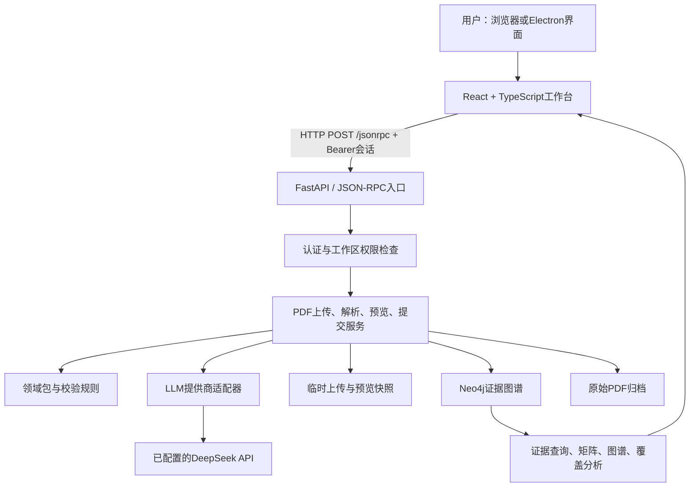

# OntoForge 课程设计汇报与答辩准备

核对日期：2026-10-30。依据当前代码及 condition-guard-final 实测记录。本文是技术准备材料，不是要求逐字朗读的演讲稿。A/B/C为仓库既有分工代号，请按真实成员与实际交付填写；不凭本文认定个人贡献。

## 1. 设计思想：解决什么问题，为什么这样设计

### 汇报内容

科研论文中的结果通常散落在摘要、正文、表格与脚注中。直接搜索能找到关键词，却很难回答“哪个模型在什么训练集和测试条件下得到这个指标，原文证据在哪里”。仅让模型生成总结，又容易出现数值正确但实验归属错误的问题。

本项目将任务限定为“可追溯的文献证据整理”，当前演示领域是目标检测准确率与推理速度。核心流程是：PDF → 文本片段 → 领域约束下的指标断言 → 校验与预览 → 图谱存储 → 矩阵/图谱/覆盖分析 → 原文复核。

三个设计原则：

1. **结果必须带证据。** 不只保存73.2，还保存论文、指标、训练数据、测试集、模型变体与来源片段ID。
2. **模型负责提出候选，程序负责约束。** 模型输出不能直接成为可信数据库事实；需要检查类型、单位、来源、范围和实验条件。
3. **允许不知道。** 原文证据不足时保留unknown和待核对原因，不用模型记忆补齐成确定条件。

### 关键取舍

- 选择领域包，而非把全部CV知识写死在代码中：领域包集中管理指标、别名、单位、分类和抽取规则，便于扩展；但新增领域仍需验证，不能只换配置就声称可用。
- 选择图数据库：论文、片段、断言和审核关系天然需要跨节点追溯。关系型数据库也能实现，本项目选择Neo4j是为了直接表达和查询证据链，而不是因为SQL“做不到”。
- 选择预览与提交两阶段：真实模型有随机性，用户确认的应是已看到的快照，不能点击提交时重新抽取并换掉结果。
- 首先完成小范围闭环：这次选择三篇经典检测论文做开发与演示，不声称已覆盖整个CV领域。

### 实际案例

Fast R-CNN的320ms不包含候选生成，不能直接与包含所有步骤的Faster R-CNN速度比较；候选网络的VGG16也不能自动填入检测器骨干。这说明“实验条件”是数据的一部分，而不是可有可无的备注。

## 2. 项目分工与贡献边界

现有《课程设计分工.md》约定三人按接口边界协作：

| 成员 | 模块边界 | 现场应能解释 | 可提供的证据 |
|---|---|---|---|
| A | PDF解析、领域约束抽取、Assistant集成 | 分批策略、模型请求、截断处理、单位转换、条件校验 | semantic_extractor.py、condition_validation.py、真实诊断与失败记录 |
| B | 本体/图谱、提交一致性、覆盖分析 | 全局ID、事务、幂等、证据方向、覆盖公式 | pdf_ingestion_service.py、coverage_analysis.py、图谱回读结果 |
| C | 前端工作台、认证权限、运行交付 | JSON-RPC调用、会话身份、角色授权、错误展示、启动方式 | auth_service.py、app.py、前端调用、权限测试 |

共同工作包括contract约定、跨模块联调、真实样本检查和最终验收。上述是分工依据，必须用真实提交和交付物确认“谁实际做了什么”。若实际分工不同，应修改此表，不能为汇报虚构三人的工作。

**代码来源必须主动交代。** 当前仓库有老师基线、同学版本及后续AI辅助开发历史。README描述了多阶段开发；交付记录保留了替换前版本5a64e05、同学版本导入e09240d。不能把当前全部代码都称为本组原创，也不能把调用AI写代码隐去。

建议准备三列对照：“基线已有 / 本组实际修复或新增 / 验证证据”。近期可核实的增量包括中文界面整理、厂商适配与真实调用、CV规则、截断保护、实验条件证据校验和复现实测资料；个人归属按实际参与确认。提交记录能帮助追溯版本，但本身不能证明某位成员理解或独立编写了实现。

## 3. 软件架构与一次请求的数据流



### 各层职责

- 表现层：上传、预览、待核对提示、矩阵与图谱浏览、模型配置、语言切换。前端不是权限边界。
- 协议层：JSON-RPC方法分发、Pydantic结构校验、统一结果与错误。SSP是项目的Scientific Service Protocol约定，不应宣称为外部已认证标准。
- 服务层：解析、分批抽取、归一、条件校验、审核和覆盖统计。
- 模型适配层：统一StructuredOutputRequest/Result，隔离厂商协议和限流差异。
- 持久层：Neo4j保存关系数据；原始PDF、预览、用户及配置分别使用本地文件存储。并非所有状态都在Neo4j。

### 上传一篇论文时实际发生什么

1. 用户登录得到会话token；请求携带Authorization头。
2. 后端验证身份、工作区写权限，接收PDF并返回upload_id和SHA-256。
3. parsePdfWithDomainPack读取上传文件，解析片段，加载CV领域包，顺序调用模型。
4. 校验输出，生成preview_id快照，返回候选、证据与批次诊断。
5. 用户确认后commitParsedPdf提交同一快照，不重新调用模型。
6. 后端再次检查上传归属、快照绑定和证据，图事务写入论文、片段、断言与关系，并归档原PDF。
7. 前端通过getPapers/getAssertions/getEvidence重新查询；不是仅在本地追加一行假数据。

## 4. 核心模块、API与数据contract

### 4.1 PDF与抽取模块

PDF解析优先使用项目配置的pypdf/Marker路径。pypdf可提取页级文本，但不保证密集表格行列完整，也不提供真实精细区域时就不能伪造坐标。

长文按片段数和字符规模分批；CV配置每批字符上限14000，实际还受环境配置限制。顺序执行，保留全部批次状态。模型输入包括领域指标定义、允许单位、上下文、领域规则、文档身份及证据片段。

输出通过结构适配与Pydantic校验，再检查指标是否允许、数值是否有限及在范围内、单位是否支持、来源ID是否有效、数值是否出现在引用文本中。明确允许秒到毫秒的换算，保存reported_value、reported_unit和换算因子；不把延迟倒数自动变成FPS。

“数值在文本里出现”只是必要条件，无法证明该数字属于正确表格行或实验。

### 4.2 新增实验条件校验

配置项require_condition_evidence在CV领域开启，其他领域默认关闭。

- timing_scope支持end_to_end、detector_only_excludes_proposals、proposal_only、component_only、unknown。
- 已知速度范围需要timing_scope_evidence，包含source_chunk_id和quote；来源必须在当前候选的引用中，引句须可回查，并匹配相应范围表述。
- 组件范围明确时，不作为完整检测器速度保留；证据缺失或不一致时，范围降为unknown。
- detector_backbone与proposal_backbone分开记录；旧backbone只映射经过检查的检测器骨干。
- reported_experiment_conditions保留模型原报告条件，condition_validation_issues列出原因，review_required要求后续核对。

目前是保守引句与关键词检查，不是完整的语义证明。连续引句要求会错过跨段、表格与脚注组合证据，因此可能过度降级。

### 4.3 图谱与一致性

核心节点：WorkspaceNode、PaperNode、ChunkNode、FormulaNode、AssertionNode，以及领域和意图相关节点。

证据关系方向：Chunk/Formula → EVIDENCED_BY → Assertion。关系名容易让人误读，现场应按实际代码说明方向。论文通过CONTAINS关联断言及内容。

paper_id按“工作区ID + 领域命名空间 + PDF内容哈希”计算。局部chunk_p1_0等ID加paper_id前缀，避免多篇论文的片段撞名。同一工作区同一领域重复提交同一PDF，跳过重复写入；不同工作区可以分别导入。

提交使用Neo4j事务，并对现有工作区加写锁，防止并发重复提交；缺失关系端点时回滚。当前工作区级锁较粗，会限制同工作区并发写入。PDF文件与图事务不是同一个分布式事务，失败时仍可能有孤立归档文件，需要后续清理机制。

### 4.4 核心接口表

统一使用POST /jsonrpc；受保护请求携带Authorization: Bearer <session-token>。

| 方法 | 核心输入 | 核心输出 | 主要约束 |
|---|---|---|---|
| authLogin | username、password | 会话token、用户信息等 | 密码校验；不要打印token |
| createWorkspace | name、root等 | workspace | 所有者由登录身份确定 |
| uploadPdf | workspace_id、file_name、content_base64 | upload_id、sha256、size_bytes、expires_at | 上传归属、类型与大小检查 |
| parsePdfWithDomainPack | workspace_id、domain_pack_namespace、upload_id | preview_id、assertions、chunks、diagnostics、status | 上传可访问；产生预览，不写入论文图谱 |
| commitParsedPdf | 上述三项及preview_id | paper_id、创建数量、status | 同一快照绑定；校验；幂等与事务 |
| getAssertions | workspace_id，可选paper_id/metric_name | 候选值、状态、证据数量 | 工作区访问检查 |
| getEvidence | workspace_id、paper_id、metric_name | 支撑片段、公式及相关断言信息 | 回查证据，不能跨工作区访问 |
| getPaperSource | workspace_id、paper_id | PDF Base64、类型与文件名 | 归档原件下载需鉴权 |
| getCoverageAnalysis | workspace_id及可选维度 | matrix、coverage、gaps | 分析范围限于当前工作区 |
| parseUserIntent | workspace_id、user_id、message | parsed_intent | 登录身份覆盖客户端user_id；不等于执行操作 |
| listAgentCapabilities | 过滤条件 | 能力元数据和schema | 声明能力不代表都已有完整执行器 |

以下请求是说明contract的简化示例，ID为示例值：

```json
{
  "jsonrpc": "2.0",
  "id": 12,
  "method": "parsePdfWithDomainPack",
  "params": {
    "workspace_id": "workspace_example",
    "domain_pack_namespace": "cv_detection",
    "upload_id": "upload_example"
  }
}
```

提交只发送preview_id等引用，不让前端随意提供一整套“可信候选”替换服务端快照。预览绑定上传内容哈希、工作区、领域及配置哈希；原件或规则改变应重新预览。

断言contract示意如下；这是结构说明，不冒充本轮模型原始输出：

```json
{
  "assertion_id": "local_assertion_id",
  "subject": "cv_detection:voc_map50",
  "predicate": "equals",
  "object": "73.2",
  "unit": "percent",
  "context_conditions": {
    "scenario": "voc2007_test",
    "training_data": "VOC07 trainval + VOC12 trainval",
    "detector_backbone": "unknown",
    "proposal_backbone": "unknown",
    "timing_scope": "not_applicable",
    "review_required": true
  },
  "evidence_links": [{"source_id": "chunk_p7_0", "confidence_score": 0.9}]
}
```

object当前以字符串承载值；数值型指标仍要按领域配置解析并校验。持久化后局部ID会加论文前缀。

### 错误与状态也是contract

- 未登录错误码-32001；没有权限-32003。JSON-RPC错误可能用HTTP 200承载，前端必须检查error，不能只看HTTP状态。
- parsed表示技术解析状态，不表示科研断言已正确；committed表示提交成功，不表示人工核验。
- 当前Paper的import_status写成verified容易产生歧义，但Assertion仍可为pending。汇报时应解释为导入完成；后续应拆分导入状态和科学核验状态。
- 模型截断、失败批次、可重试标志与警告需保留；不得将失败伪装为空结果或静默使用模拟数据。

## 5. Assistant集成情况

### 已实现且本轮真实验证

LLMProviderConfig、StructuredOutputRequest和StructuredOutputResult统一模型配置与响应。提供商适配器负责API地址、认证、请求参数、usage和finish_reason；SemanticExtractor负责领域抽取及结果约束。

本轮使用用户已配置的deepseek-flash，三篇PDF均实际调用模型。模型不是只生成一段总结，而是返回带上下文和引用的结构化候选，再进入校验、预览和图谱流程。

真实问题：首次DeepSeek将4096输出额度用在思考，出现length和不完整输出；系统拒绝将其当成功结果。随后仅对DeepSeek抽取请求关闭思考，保留原额度与规则继续验证。智谱免费模型采用其专属串行/有限重试策略，不让此限制影响其他提供商。

### 已有实现但本轮未重新验收完整应用流程

parseUserIntent可将用户文本转换为结构化意图；能力注册表提供输入输出schema、可变性及确认策略。不能用“有schema、有测试”代替真实聊天操作的完整验收。

### 尚未完成

processChatMessage目前在contract与能力注册表中出现，但没有找到完整对应的服务端JSON-RPC执行流程；不能宣传为已经落地的通用聊天Agent。也没有可宣称的自主检索、规划、调用任意工具、可靠执行研究任务的完整循环。

还需要将能力声明与真实执行器一致性纳入测试，并在执行端实施权限与确认策略；不能只靠模型返回requires_confirmation或注册表写confirm保证安全。

## 6. 认证与权限管理

认证回答“是谁”：本地用户注册表使用随机盐、PBKDF2-HMAC-SHA256、200000轮保存密码哈希；登录生成随机会话token，默认8小时有效。会话在内存中，服务重启失效，已提交图谱数据不因此丢失。当前不是JWT，也没有OAuth/单点登录。

授权回答“能做什么”：工作区owner/editor可以写，viewer只读。成员管理等敏感操作需按具体接口检查所有者权限。后端从token建立请求级Identity，不接受客户端owner_id作为身份凭证。

上传不仅检查upload_id存在，还检查身份与工作区归属。图谱和证据修改也需要工作区授权；前端隐藏按钮只是交互措施。

当前仍有边界：无owner的历史工作区对登录用户保留只读兼容，不能声称历史数据完全隔离；parseUserIntent当前确认身份但还需统一补足工作区可见性检查。权限应逐接口审计，不能笼统宣称所有路径都绝对安全。

适合演示：A拥有工作区，B未被授权时不能读取/修改；添加B为viewer后可读但不能写。现场演示前按真实账户验证，不共享真实token到PPT或截图。

## 7. 初步性能与扩展性分析

### 最新实测：真实DeepSeek、固定v1论文、顺序请求

| 论文 | 页数 | 模型批次 | PDF解析秒 | 模型阶段秒 | 单篇抽取调用秒 | 原始候选 |
|---|---:|---:|---:|---:|---:|---:|
| Fast R-CNN | 9 | 5 | 0.574 | 23.003 | 23.640 | 8 |
| Faster R-CNN | 10 | 4 | 0.937 | 27.544 | 28.547 | 10 |
| YOLO | 9 | 3 | 0.577 | 15.323 | 15.954 | 5 |

单篇抽取调用累计68.141秒；它包含解析和模型等待等，不含整个交互流程的全部上传、提交和人工核对时间。12批均stop，无失败批次；仍有单条格式警告，因此批次成功不代表候选完整。

45项相关后端测试、前端TypeScript检查通过；这不是本次全套测试结果，也不替代抽取质量评估。历史全套验收数字只能注明当时版本与环境，不能并入本轮冒充当前全部复验。

本次主要瓶颈是外部模型请求，不是PDF解析。只有三篇、单次、单用户顺序试验，没有P95、并发吞吐、万篇规模或数据库单独查询压测数据，不能给出不存在的性能保证。

### 扩展方案与代价

- 上传Base64体积约增加三分之一，并使请求体驻留内存；大文件应改multipart或对象存储引用，配合网关请求体限制。
- 抽取放入任务队列，返回job_id并提供进度与取消；按提供商限流，在允许时使用有上限并发，不能无差别并行。
- 内存会话迁移到共享存储，用户/配置文件迁移到事务性存储，才能支持多个后端实例；进程内锁不能跨进程保证一致性。
- 图谱查询需分页、合适的索引和投影；工作区级写锁未来可细化，但必须继续保证重复提交幂等。
- 覆盖统计设N条断言、M种方法、S种场景、K种指标，主要建表扫描约O(N+MSK)，空白排序约O(G log G)，G不超过MSK。维度膨胀时需稀疏矩阵和范围限制。
- 扩展到新领域要重新定义指标与实验条件、准备独立测试论文，不能把当前三篇开发样本当泛化证明。

## 8. 当前结果、未实现内容与汇报边界

### 当前可展示的数据

工作区：**CV目标检测 · 汇报验证集（保留）**。已保留3篇原始PDF、23条原始pending候选，均有证据链接，原件回读哈希与输入一致。

另有8条从本轮真实输出中选取、经AI辅助原文核对的mAP记录，包含训练/测试条件、论文页码和原始候选。它们在独立reporting-dataset.json和汇报数据.md中；不是数据库里23条全被人工核验，也不是8/23的准确率。

关键限制：本轮23条候选均缺少合格检测器骨干引句，全部受检条件自动通过的候选为0；8条示例数据需要独立的原文补充和核对。保守校验已实现，但全自动可靠提取未完成。

### 尚未完成的主要内容

1. 高质量表格行列与脚注联合还原；跨片段实验条件关联。
2. 精确区分整套测试集运行时间与单图延迟。YOLO110秒仍可能成为110000ms待核对候选，已排除出汇报数据。
3. 跨批次按完整实验身份去重和系统性补漏。
4. 独立人工标注、盲测与precision/recall/F1评估；当前三篇参与规则调整，属于开发样本。
5. 既有分工中10—20篇真实论文完整质量验收目标；下载过更多PDF不等于完成模型抽取与核验。
6. 现代COCO等更广场景的真实验证。
7. 完整聊天Agent执行闭环及能力声明一致性。
8. 分布式认证、任务调度、企业级部署与大规模压测。

Coverage已能统计方法×场景×指标的证据覆盖，空白候选只表示当前导入数据缺覆盖。现实现会读取包括pending在内的断言，质量差和未知上下文会影响结果；不能把它直接解释为全球科研空白，也不能宣称已证明发现研究创新点。

## 9. 潜在安全风险：已有措施与剩余问题

| 风险入口 | 当前措施 | 仍需补足 |
|---|---|---|
| 论文提示词注入 | 明确把论文当不可信证据；限制指标和输出；不直接执行论文内容 | 提示词约束不是安全证明，可能诱导错误数据；执行器必须单独授权 |
| 工作区越权 | 服务端Identity、角色与上传归属检查 | 历史无owner兼容、意图接口等需持续逐项审计 |
| 恶意或过大PDF | PDF类型/签名与默认25MiB字节上限；后端管理路径 | 上传解码前请求体限制、解析沙箱、页数/CPU/内存限额、依赖漏洞维护 |
| API密钥与日志 | 不向前端回传明文密钥；默认不记录正文；Windows使用DPAPI保护 | 非Windows实现存在local明文存储路径；主机权限仍关键，日志和异常需持续检查 |
| 自定义模型地址 | URL格式校验，不允许URL内凭据等 | 仍可能访问内网地址，形成SSRF或把论文送往不可信服务；需地址白名单/出站策略 |
| 文献隐私 | 密钥和会话不写入测试资料 | 实际API调用会把选定论文内容发给提供商；保密论文需校内或本地模型方案 |
| 原始Cypher/文件访问 | 默认限制高风险入口，查询需按作用域约束 | 配置打开后仍要审计，关键词过滤不等于完备安全边界 |
| 会话和本地部署 | 随机会话、有过期、密码哈希 | 缺少完整登录限流、MFA、统一会话撤销和生产TLS部署方案 |
| 模型数据污染 | 候选pending、原始输出留存、证据与unknown标记 | 高置信度也可能错；错误候选会污染分析，需要审核过滤和追溯 |
| 文件与数据库一致性 | 图事务和文件哈希校验 | PDF归档和图提交跨存储，失败残留文件及备份恢复尚需治理 |

## 10. 建议的现场组织：用证据说明工作量

可按约12分钟准备，实际按老师时间调整：设计1分钟、分工与来源1分钟、架构1.5分钟、核心contract与实现3分钟、Assistant与权限2分钟、实测与边界1.5分钟、演示1分钟。

不必每页堆满代码。核心代码各选一段：A讲_extract_batch与validate_conditions；B讲_commit_atomic及paper_id生成；C讲会话解析与authorize_workspace。每人能不看稿解释输入、判断、输出和失败路径。

演示优先使用已保留数据，真实API调用耗时另展示诊断；不要在课堂上以反复付费重跑代替讲清实现。可以展示一次正常证据回查、一次待核对原因、一次无权限拒绝。

本项目复杂度应通过跨模块约束体现：预览快照与提交一致性、来源ID和哈希绑定、跨用户隔离、图事务、模型失败处理、实验条件证据检查。页面数量、代码行数或AI生成了多少内容不能单独证明工作量。

## 11. 模拟提问与参考回答

### Q1：一句话说你们做的是什么？

面向限定领域的论文证据工作台，把PDF中的指标整理成带实验条件和原文来源的候选数据，支持审核、图谱浏览和覆盖分析。目前三篇目标检测论文跑通了真实模型流程。

### Q2：为什么不能直接让ChatGPT总结论文？

普通总结缺少稳定的数据结构和证据关联。我们的结果可按论文、指标、实验条件查询，并回到片段和PDF；同时将模型错误显式留在待核对状态。我们没有声称已经消灭模型错误。

### Q3：这么多功能，哪些是你们自己做的？

先说明老师基线、同学版本和本组实际修改范围，再拿对应提交、差异、测试与真实案例说明。我只把自己参与且能解释的实现归入个人贡献，不把整个仓库包装成独立原创。

### Q4：你们用了AI写代码，怎么证明不是照搬？

AI参与了实现与资料整理，这一点如实说明。理解和工程贡献通过现场解释代码、说明为何这样设计、复现失败和验证修复来证明。不能仅凭工具生成的提交或演示视频证明个人完成；每人都要掌握自己负责的边界。

### Q5：为什么选择Neo4j，SQL不行吗？

SQL可以实现。我们主要查询论文—断言—证据的关系，图模型表达直接，也便于扩展关系类型。代价是引入单独服务、Cypher和事务管理，对简单表格场景不一定比SQL省事。

### Q6：一次上传会立刻写进图谱吗？

不会。先上传，再解析成服务端预览快照，确认时提交preview_id。这样用户看到的候选与提交的数据一致，也可以在提交前拦住模型失败。

### Q7：为什么提交不能再调用一次模型？

模型可能输出不同结果。确认的是某个快照，所以提交只读取绑定过的结果，并检查内容和规则哈希；否则“我确认的”和“保存的”可能不同。

### Q8：重复点提交会重复入库吗？

同一工作区、领域和内容哈希决定稳定paper_id；提交在图事务内持有工作区写锁，已有论文时跳过创建。不同工作区允许各自导入。当前规则也意味着同一PDF更换抽取配置不会自动更新已入库论文，后续需要版本化重抽取机制。

### Q9：你们怎么防止两篇论文都叫chunk_p1_0而串证据？

解析阶段允许局部ID，持久化时统一加paper_id前缀；模型引用先验证在当前片段集合中存在，再转换成全局ID。不是只靠PDF页码区分。

### Q10：数值就在原文里，为什么还会错？

同一页可能同时有整体mAP、类别AP、基线和消融；一个数存在不代表归属正确。我们当前补的是实验条件证据约束，表格行列理解与跨段关联仍未完全解决。

### Q11：本轮最真实的失败是什么？

DeepSeek默认思考耗尽4096输出额度，返回length而没有完整数据。诊断中的reasoning_tokens与finish_reason定位了问题；关闭抽取思考后重跑，失败记录仍保留。这是接口适配问题，不是并发问题。

### Q12：你们是否为得到漂亮结果调大额度或偷偷改了数值？

主对照保留原输出额度，适配参数和运行版本单独记录。展示数据从真实候选选取，数值不改；补充条件写进独立核对文件并嵌入原始断言。未知条件和错误候选不悄悄删除成“全部正确”。

### Q13：新增条件校验到底做了什么？

检查范围和骨干的引句是否来自已引用片段、是否在原文中存在并包含基本角色线索。缺失就降为unknown、记录原值与问题；明确的组件耗时排除。它是保守校验，不是完整语义验证。

### Q14：为什么结果很多条件变成unknown？是不是优化失败？

证明条件不足时保留确定值会误导。现在至少能让这种不确定性显式呈现；但过度降级也说明可用性仍不足。本轮全部受检条件自动通过为0，我们没有把它包装成准确率提升，后续需要表格证据、跨段证据和独立评估。

### Q15：8条数据是准确率8/23吗？

不是。8条是经过选择和AI辅助原文核对的演示数据，23条是原始候选；没有给全部输出做独立标注，也没穷举应提取项，所以不能从这个比例计算准确率、召回率或F1。

### Q16：老师能拿你们的数据做模型性能排名吗？

不能直接排名。训练数据、测试年份、网络与评估条件不同。展示表保留条件，就是为了防止只按数字大小比较；速度还受硬件、输入分辨率和计时范围影响。

### Q17：为什么不把320ms倒数换算成FPS？

FPS可能按吞吐测量，与单图延迟、批大小和计时范围不同。当前只执行显式配置的单位换算，例如秒乘1000到毫秒，不额外推导未报告性能指标。

### Q18：Assistant现在能自动调用工具吗？

当前核心是受约束抽取，另有结构化意图解析和能力声明。processChatMessage完整执行流程未完成，不能说通用Agent已实现。将来执行动作仍需服务端权限、参数验证和确认机制，不应让模型绕过接口边界。

### Q19：伪造owner_id能进入别人的工作区吗？

正常受保护路径以Bearer会话解析的Identity为准，客户端owner_id不是授权依据；随后按工作区角色检查。历史兼容和个别接口还需要统一审计，因此我不会宣称完全不存在越权风险。

### Q20：HTTP返回200，前端为什么还显示失败？

JSON-RPC的业务错误可以在HTTP 200正文的error里返回。前端必须检查error.code/message，不能把传输成功当成业务成功。例如没有权限是-32003。

### Q21：verified是不是说明论文数据正确？

现有Paper.import_status命名有歧义，它表示导入流程完成，不能等同断言人工审核。原始Assertion仍为pending。本次报告明确区分，后续应把两类状态拆开。

### Q22：你们的“研究空白”怎么算？

先在当前工作区按方法、场景、指标建覆盖单元，缺证据的组合成为候选，再按周边维度活跃度排序。不是通过全网检索证明没人做过。当前pending也可能计入，故还需质量过滤。

### Q23：性能瓶颈在哪里，能同时处理100个人吗？

本轮三篇累计约68.14秒，主要在模型等待。没做100人并发压测，不能承诺。当前内存会话、本地配置、串行请求与粗粒度提交锁都限制扩展，需要任务队列、共享存储和分提供商限流。

### Q24：你们的API密钥安全吗？

Windows后端用DPAPI保护，前端不回传明文，日志默认隐藏敏感内容。但主机被控制仍有风险，非Windows路径也没有同等级保护；自定义地址可能引入SSRF和文献外传，需要额外部署策略。

### Q25：数据库写失败会怎样，能保证文件也一起回滚吗？

图节点与边在Neo4j事务内回滚，避免半个图；但PDF归档是文件操作，不在同一数据库事务里，可能留下孤立文件。哈希防止错件，清理与恢复机制仍需完善。

### Q26：下一步最该做什么，而不是再加功能？

先让老师或研究者独立核对这8条展示数据，再准备未参与规则调试的新论文评估；技术上改善表格行列和范围判定，补去重与遗漏检查。先证明数据可靠，再扩大领域和自动化范围。

## 12. 答辩前每个人必须亲自做的事

- 打开自己负责的两段关键代码，不看材料解释输入输出、异常路径和一项取舍。
- 用已保留数据完成一次证据回查，找出一个正确样例和一个需核对样例。
- 说清自己的真实贡献与基线来源；不要把分工计划当已完成事实。
- 复核PPT上的每个数字，注明对应运行；移除真实密钥、密码与token。
- 不背整篇，记住“问题—设计—实现—验证—边界”五个要点，用现场操作和代码回答追问。

## 证据索引

- 三人分工：../课程设计分工.md
- 整体与历史：../README.md、DELIVERY_ACCEPTANCE.md（历史状态，不能替代最新实测）
- 最终运行：cv-validation/condition-guard-final/run-summary.json
- 持久化：cv-validation/condition-guard-final/persistence-check.json
- 展示数据：cv-validation/condition-guard-final/汇报数据.md、reporting-dataset.json
- 结果边界：cv-validation/condition-guard-final/REPORT.md、assessment-summary.json
- 抽取：../backend/services/llm/semantic_extractor.py
- 条件校验：../backend/services/llm/condition_validation.py
- 提交与预览：../backend/services/pdf_ingestion_service.py
- 身份权限：../backend/services/auth_service.py、../backend/server/app.py
- contract：../backend/schemas/protocol.py
- 能力声明：../backend/services/llm/capability_registry.py
- 覆盖分析：../backend/services/coverage_analysis.py
